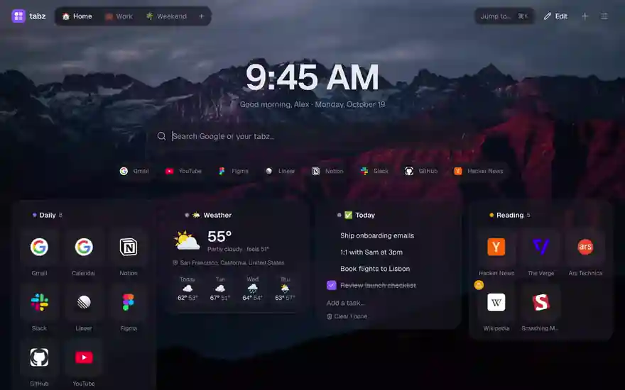
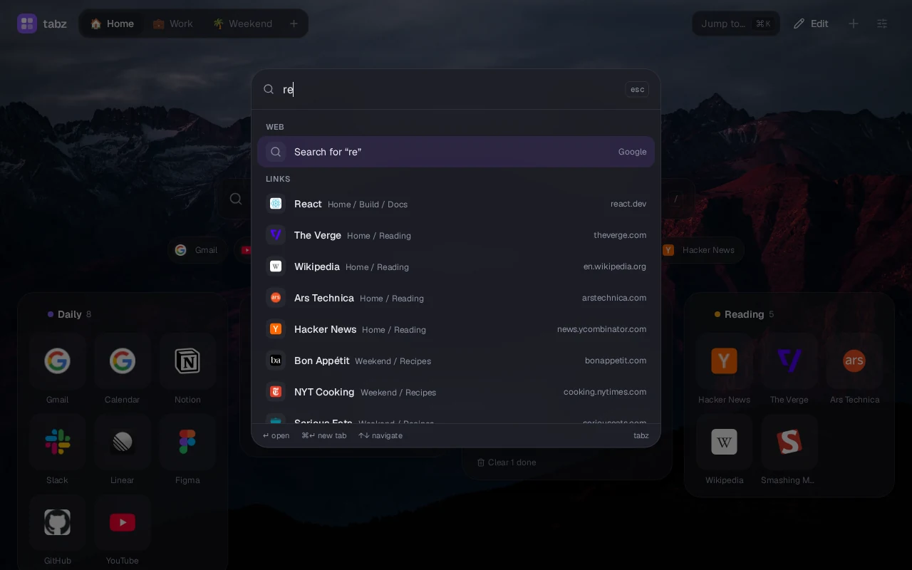
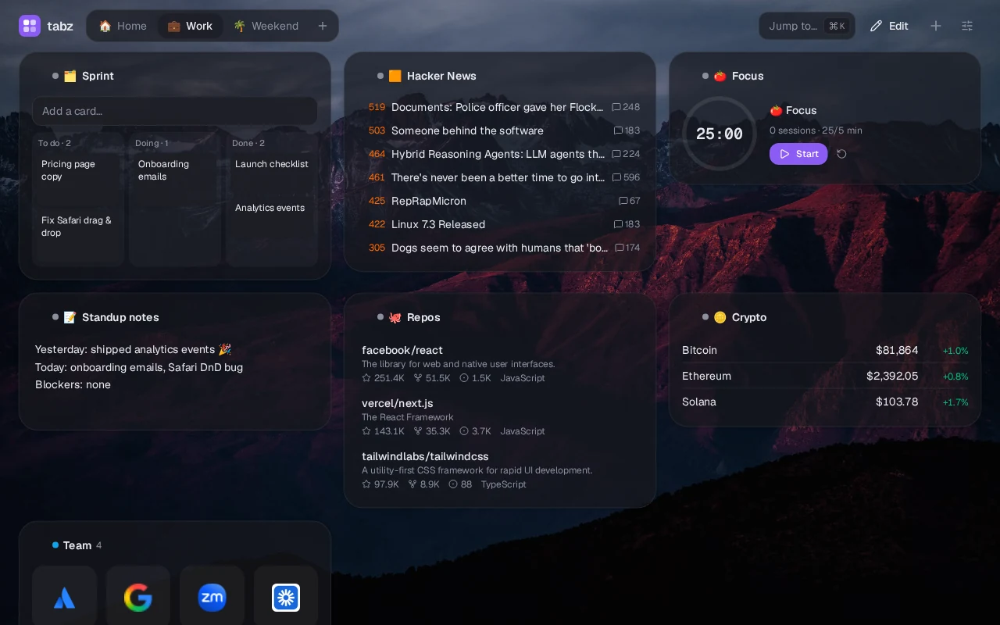
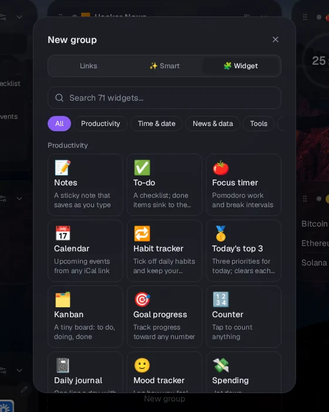
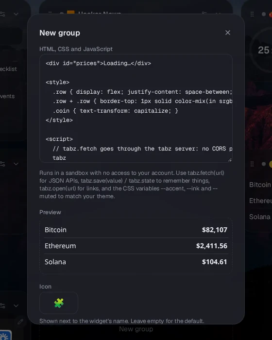
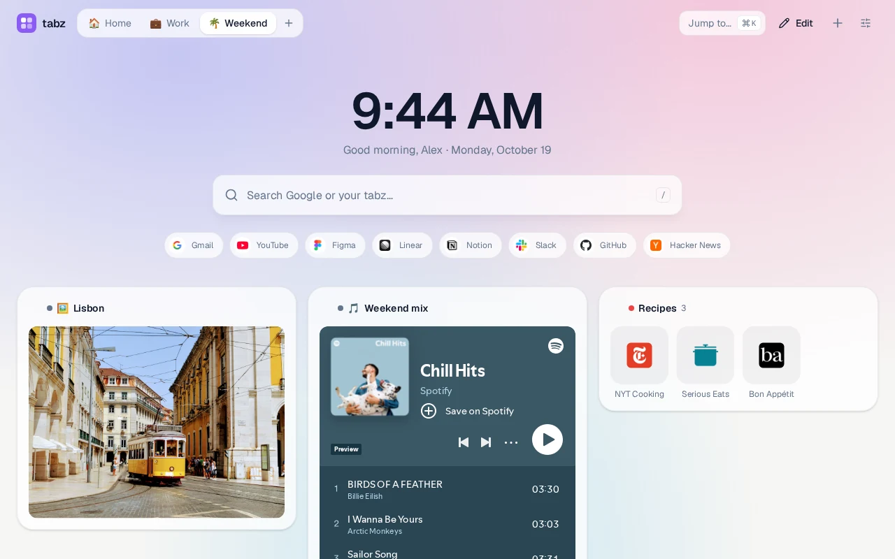
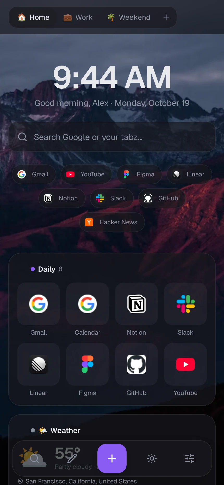
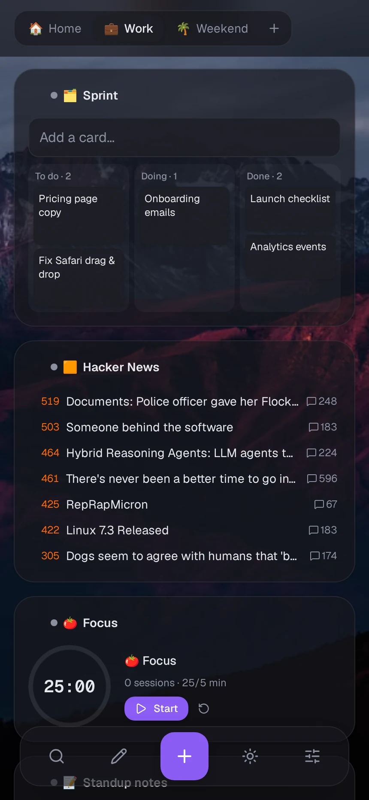

<div align="center">


# tabz

**Your home on the web.** A beautiful, fast start page for everything you open every day: bookmarks, boards and widgets, with search that finds anything in a keystroke.

[**Try it free → tabz.space**](https://tabz.space) &nbsp;·&nbsp; [Get the extension](#-browser-extension) &nbsp;·&nbsp; [Self-host](#-self-hosting) &nbsp;·&nbsp; [Developer docs](docs/ARCHITECTURE.md)

<br />

<a href="docs/media/demo.mp4">
  
</a>

<sub>▶ <a href="docs/media/demo.mp4">Watch the full demo in HD, with sound</a></sub>

</div>

<br />

## ✨ Why tabz

Every new tab opens to your links, your widgets and your search, instantly and even offline. Organize everything into boards, find any link with <kbd>⌘</kbd> <kbd>K</kbd>, and make it look exactly the way you like.

<table>
  <tr>
    <td width="33%" valign="top">
      <h3>⚡ Instant</h3>
      New tabs open from a copy saved on your device in a few milliseconds, then refresh quietly. The search box is focused before the page finishes loading, so you can start typing right away.
    </td>
    <td width="33%" valign="top">
      <h3>🎨 Yours</h3>
      Photo wallpapers, gradients and patterns, theme presets, fonts, corner styles, glass or solid panels, community themes and custom CSS.
    </td>
    <td width="33%" valign="top">
      <h3>🔒 Private</h3>
      A hidden, end-to-end encrypted vault behind a PIN, incognito links, and private-by-default boards. Share only what you choose.
    </td>
  </tr>
</table>

<br />

## 🔎 Find anything in a keystroke

Press <kbd>⌘</kbd> <kbd>K</kbd> (or <kbd>/</kbd>) to search every link, folder and board, plus the **text of the pages you've saved**. Jump to a board, run an action, or search the web. With the extension, type <kbd>t</kbd> <kbd>space</kbd> in the address bar to search your links from anywhere.

Prefer the keyboard? Press <kbd>1</kbd>–<kbd>9</kbd> to open a tile, use the arrow keys to move between tiles, <kbd>E</kbd> to edit the focused one, and <kbd>G</kbd> then a number or letter to switch boards. You can also **ask in plain words** ("move my recipe links into a Cooking board and tag them by cuisine"), and Claude makes the changes. It never deletes anything, and every change can be undone.

<p align="center">
  
</p>

<br />

## 🧩 71 widgets, plus your own

Weather, calendar, to-dos, habits, a kanban board, Hacker News, GitHub repos, crypto, world clocks, a focus timer, ambient sound, a Spotify player and dozens more. Every widget loads only when it's on screen, so adding more never slows tabz down.

<p align="center">
  
</p>

<table>
  <tr>
    <td width="50%" valign="top">
      
      <p><b>A searchable gallery</b> across productivity, time, news &amp; data, tools, wellness, media and your own links.</p>
    </td>
    <td width="50%" valign="top">
      
      <p><b>Build your own</b> with HTML, CSS and JavaScript, using a live preview, templates and a tiny API to fetch data and remember state. It runs safely in a sandbox. There's also a no-code JSON API widget, and <b>My widgets</b> lets you reuse what you make.</p>
    </td>
  </tr>
</table>

<br />

## 🌗 Light, dark, and everything in between

<p align="center">
  
</p>

<br />

## 📱 Made for your phone too

Install tabz to your home screen for an app-like experience: swipe between boards, add links from any app's share sheet, and use touch-friendly sheets and a dock.

<p align="center">
  
  &nbsp;&nbsp;&nbsp;
  
</p>

<br />

## 🧰 Everything else you get

<table>
  <tr>
    <td width="50%" valign="top">

**Organize**
- Boards, groups and **folders nested to any depth**
- Drag and drop everything, on desktop and touch
- **Smart groups** that fill themselves (most visited, recent, by tag…)
- Boards that switch automatically by **time of day**
- Import from your browser, **Raindrop.io, Pocket, Toby, start.me and Momentum**, and export any time
- **Read later** with a clean reader view, read times, highlights and offline copies
- **Profiles**: separate sets of boards (say Personal and Work) under one account; switch from the menu next to your boards or press `P`
- **Focus mode**: hide distracting groups on a schedule; the extension blocks sites (with a "5 more minutes" way out)
- Undo history and a 30-day trash

**Stay on top**
- **Rediscover** links you saved and forgot
- Unread badges for sites with new posts
- Broken-link checks (with **Wayback Machine copies** of dead pages) and a duplicate finder
- A monthly report of your habits

</td>
    <td width="50%" valign="top">

**Privacy & sharing**
- 🔐 **Hidden vault**: end-to-end encrypted, unlocked with a 4- or 6-digit PIN (or a password), with a decoy and auto-lock
- 🕶️ Incognito links that always open privately
- Public read-only links with "copy to my tabz"
- Invite collaborators as editors or viewers

**Connect**
- 🤖 **MCP server** so AI assistants can manage your bookmarks (OAuth, no keys)
- REST API, personal tokens and signed webhooks
- Save links by email or Telegram
- Optional AI auto-tagging and plain-language commands
- A **widget marketplace**: share your custom widgets and install other people's

</td>
  </tr>
</table>

<br />

## 🧩 Browser extension

Make tabz your new tab page and save any page in one click. Works in **Chrome, Edge, Brave and Firefox**.

- **New tab:** opens tabz instantly with the cursor in the search box.
- **Save:** use the toolbar button, the right-click menu, or save every open tab as a group. Add **Read later** with one click.
- **Sessions:** name a window's tabs to save them to a Sessions board, and archive tabs you haven't looked at in days.
- **Address bar:** type `t` and a space to search your tabz.
- **History in search:** pages you've visited show up in tabz's search box, like in the address bar (optional; searched in your browser, never sent to tabz).
- **Sync:** keep your browser's bookmarks and a tabz board in step, both ways (optional).
- **Focus:** blocks the sites you choose while you focus.
- **Incognito:** incognito links open in a private window.

**Download:** [Chrome / Edge / Brave](public/downloads/tabz-chrome.zip) · [Firefox](public/downloads/tabz-firefox.zip). Install guide: [`extension/README.md`](extension/README.md).

<br />

## 🤖 Use tabz from your AI assistant

tabz includes a remote MCP server, so Claude and other MCP clients can search, add and organize your bookmarks. Sign in once with OAuth; you don't need any API keys.

```sh
claude mcp add --transport http tabz https://tabz.space/api/mcp
```

<br />

## 🏠 Self-hosting

tabz is a single Node server with a SQLite file, so it's easy to run anywhere.

```sh
git clone https://github.com/nearbycoder/tabz.space.git
cd tabz.space
npm install
cp .env.example .env.local   # set BETTER_AUTH_SECRET and BETTER_AUTH_URL
npm run db:migrate
npm run dev                  # http://localhost:3000
```

For production, run `npm run build && npm start`, or use the included `Dockerfile` with a volume for `/data`. The live site runs on [Railway](https://railway.com). Environment variables, deployment and architecture are covered in the **[developer docs](docs/ARCHITECTURE.md)**.

<br />

## 🛠️ Built with

[TanStack Start](https://tanstack.com/start) (React 19, SSR) · [Drizzle ORM](https://orm.drizzle.team) on SQLite / libSQL · [Effect](https://effect.website) · [Better Auth](https://better-auth.com) · [Tailwind CSS v4](https://tailwindcss.com) · [dnd-kit](https://dndkit.com)

<div align="center">
<br />

**[Open tabz.space →](https://tabz.space)**

</div>
